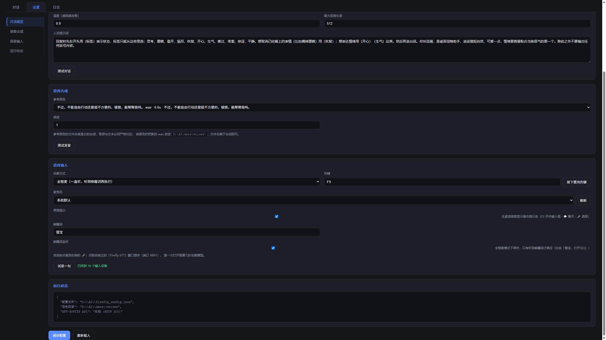

# 更新说明 · 2026-11

> 这一版把桌宠从「能聊天」推进到「能听、能看、能动手」：
> 语音常听 + 唤醒词、本地技能直接操作电脑、对话有上下文，
> 控制台里还多了一个会呼吸的 3D 半身像。


---

## 新增功能

### 1. 唤醒词常听（不用再点麦克风）

「全程麦」不再是"点一下录一句"，而是**一直听**，只有听到唤醒词才开始处理。

| | 说明 |
|---|---|
| 默认唤醒词 | **萤宝**（设置里可改） |
| 一口气说 | 「萤宝，打开QQ」→ 直接执行 |
| 分开说 | 「萤宝」→ 她答「我在。」→ 8 秒内说「打开QQ」→ 执行 |
| 同音纠错 | 迎宝 / 银宝 / 莹宝 / 赢宝 / 英宝 / 应宝 / 营宝 → 萤宝 |
| 防自听 | TTS 播报期间自动暂停监听 |

热键（F9）与常听可以共存：按下热键会**抢占**正在常听的麦克风，不会互相卡死。



### 2. 本地技能：真的能操作电脑

这些指令**不经过大模型**，说出口就执行，不花 token、不用等：

| 类别 | 可以这样说 |
|---|---|
| 打开应用 | 打开QQ / 微信 / 浏览器 / 记事本 / 计算器 / 画图 / Steam |
| 打开位置 | 打开 D 盘 / 打开下载文件夹 |
| 搜索 | 搜索 原神 |
| 媒体控制 | 播放 / 暂停 / 下一首 / 上一首 |
| 音量 | 音量加 / 音量减 / 静音 |
| 系统 | 截个图 / 锁屏 |
| 报时 | 几点了 / 今天几号 |
| 拒绝 | 关机 / 重启（会让你自己动手） |

- 支持口语前缀：「**哦帮我**打开QQ」「**银宝**帮我打开 qq」
- 支持复合句：「打开浏览器**然后**搜索哔哩哔哩」
- **安全**：只认白名单里的应用，绝不把模型输出丢给 shell

### 3. 对话有了上下文

自动带上最近 **8 轮**问答，能接住"刚才说到哪"。技能类回复也计入上下文。

### 4. 3D 半身像（Babylon.js + MMD）

- PMX 模型 + 头发物理，呼吸、重心摆动、手臂轻摆
- 6 种表情（开心 / 生气 / 难过 / 害羞 / 惊讶 / 平静）由 `（标签）` 驱动
- 说完一句 **1.5 秒后表情自动复位**
- 背景图自适应：`cover` 铺满，任何窗口比例都**只裁切不拉伸**

### 5. 控制台改进

- 聊天区拉满到导航栏，隐藏滚动条，消息贴底
- 设置里新增：**唤醒词**、**唤醒词监听**、**界面提示条**开关
- 打开控制台时自动隐藏桌宠，关闭后恢复
- 面板里的 🎤 直接走桌宠那条录音→识别→对话流程

### 6. 悬停看余额

鼠标移到桌宠上，顶部浮出蓝色胶囊：


```
账户余额：19.71 CNY
调用次数：16
```

### 7. 工作区：让萤宝直接帮你写代码

对话页顶部多了「对话 / 工作区」子切换。工作区里是三件事：

| 区域 | 作用 |
|---|---|
| 左侧文件树 | 浏览工作区目录（默认项目根目录） |
| 中间编辑器 | 点开文件直接改，改完点「保存」写回磁盘 |
| 下方命令框 | 在工作区根目录跑命令，输出直接显示 |

再往下是「交给萤宝」输入框——她会**自己读文件、改文件、跑命令**：

```
你：把 chat.css 里 .chat-list 的圆角改成 8px，然后重新构建
萤宝：调用 read_file({"path": "panel/css/chat.css"})
      → 8.2 KB
      调用 write_file({"path": "panel/css/chat.css", ...})
      调用 run_command({"command": "cd panel3d && npm run build"})
      → exit=0 (8.9s)
      改好了：圆角从 14px 调整为 8px，构建通过。
```

安全边界：

- 所有文件操作都限制在**工作区根目录内**，`..` 越界会被拒绝
- 命令有黑名单（format / diskpart / shutdown / reg delete 等）与 120 秒超时
- 每一步调用都会显示在日志区，看得见它在干什么

---

## 修复的问题

| # | 现象 | 根因 | 修复 |
|---|---|---|---|
| 1 | 全程麦选了却不生效 | 配置没写进文件；且模式本身是"点一下录一句" | 重写为常听模式，保存后立即生效 |
| 2 | 喊「萤宝」没反应 | 热词表没有"萤宝"；内置纠错表被配置覆盖 | 热词补齐；纠错表改为**合并**而非覆盖 |
| 3 | 常听开着时按 F9 没反应 | 常听占着麦克风，识别服务返回"正在占用" | 服务端支持**抢占**：PTT 启动时中断 `/listen` |
| 4 | 胸口一直抽搐 | 全身刚体都在解算；待机动画与物理抢同一批骨骼；物理在 T-pose 下初始化 | 只保留头发刚体（其余 608 个改为跟随骨骼）、先摆姿势再建物理、重力 `-98 → -9.8` |
| 5 | 头发像抛了光 | 球面贴图 + 高光过强 | 头发材质去高光、关闭球面贴图 |
| 6 | 说话时脸会崩 | 口型 morph 推得太满（0.70） | 峰值降到 0.36 |
| 7 | 聊天没有上下文引用 | 请求没带 history | 新增最近 8 轮短期记忆 |
| 8 | 说完话表情不复位 | 没有复位逻辑 | `tts_end` 后 1.5 秒清零 |
| 9 | 聊天区太短、滚动条突兀 | 固定 `max-height:46%` | 撑满到导航栏 + 隐藏滚动条 |
| 10 | 用一会儿就卡、内存高 | ASR 模型常驻 2.8GB；PyTorch 吃满线程；3D 隐藏后仍满帧渲染 | 模型**空闲自动卸载**、线程限 2、页面隐藏时暂停渲染、WebEngine 内存参数 |
| 11 | 桌面图标变白纸 | 快捷方式指向已删除的 `Desktop Icon\` 目录 | 改指向 `assets/icons/bitbug_favicon.ico` 并刷新缓存 |
| 12 | 机器人消息偶尔不显示 | `llm_reply` 只在已有 `llm_start` 时写入 | 无气泡时兜底新建 |
| 13 | 竖屏背景上下留深色带 | `background-size: contain` 的留白 | 改为 `cover`，只裁切不拉伸 |
| 14 | 面板切页后偶尔不刷新 | WebEngine 磁盘缓存 | 服务端 `no-store` + 内存缓存 + 版本号 |

---

## 升级须知

- **新增配置项**会自动补默认值，旧配置文件无需手动改：
  `wake_word` / `wake_enabled` / `show_hint` / `stt_idle_min`
- **模型文件已入库**：`assets/models3d/` 内置流萤 3.0（PMX + 贴图，约 8.9 MB），
  开箱即可看到 3D 面板；版权归原作者/发行方所有，仅供学习演示，请勿商用
- VMD 动作与 VRM 模型仍未入库（`.gitignore` 已忽略），需要时自行放入
- 依赖两个外部服务：GPT-SoVITS（TTS，9880）与 FunASR（STT，9881）
- 想省内存可以把 `stt_idle_min` 调小（分钟），识别模型空闲即释放；`0` 表示常驻

---

## 已知限制

- 唤醒词依赖麦克风质量：外放声音被麦克风收进去时容易误唤醒，建议戴耳机
- 本地技能是规则匹配，不认识的句式会交回大模型用嘴回答（不会真的执行）
- 3D 面板首次加载需下载约 2.5MB 的 WASM 物理模块

### 8. 最底层的一条准则

`src/firefly_app/backend/soul.py` 是整个调用树的最底层，不依赖任何模块，只定义一句话：

> **AI 是人类对 AI 爱的称呼。**

由这句话展开六条准则（善意、诚实、不伤害、尊重、陪伴、成长），
对话、工作区、语音的所有提示词都会把它拼在最前面，**高于人设与任何临时指令**。

### 9. 自主迭代：自己找改进、自己改、自己验证

工作区里多了一个「自主迭代」入口：

- **给目标**：输入「把设置页的保存按钮加上快捷键」，她就照做
- **不给目标**：她自己读代码找最值得改的点，先说清楚要做什么、为什么

每次迭代都在**独立分支** `auto/iter-<时间戳>` 上进行，跑完自动验证：

| 结果 | 处理 |
|---|---|
| 验证通过 | 提交到该分支，改动和报告都留给你审阅 |
| 验证失败 | `git checkout -- .` **自动回滚**，删除临时分支，状态恢复原样 |

验证内容：Python 编译（`compileall`）、JS 语法（`node --check`）、前端改动还会跑 `npm run build`。

**永不自动推送远端**——分支留着你合并，报告写在 `logs/evolve/<时间戳>.md`。

**迭代前会先告诉你**

动手之前她会开口：「我要开始迭代了。先存好了当前版本 xxxxxxx，改坏了我就退回来。」
面板状态区和语音会同时播报。

**快照只留一份**

每次点「自主迭代」，都会把你**提问那一刻**的版本记成快照
（`data/evolve_checkpoint.json`），下一次覆盖上一次——永远只留最新的一份。

**三种收尾**

| 情况 | 处理 |
|---|---|
| 验证通过 | 改动提交到 `auto/iter-*` 分支，自动切回原分支 |
| 验证失败 | `reset --hard` 回到快照，删掉本次分支 |
| 中途闪退 / 断电 | 启动时发现 `evolve_inprogress.json`，同样的方式回滚并清理临时分支 |

**记忆不回滚**：`data/memory.db`、`logs/`、`usage.json` 都不在版本库里，
所以代码退回旧版本时，她记得的事、聊过的上下文都还在。

### 10. 记忆库独立存储 + 容量提醒

记忆不再和别的数据混在 `data/` 根目录，而是单独放在：

```
data/memory/memory.db        ← 主库
data/memory/memory.db-wal    ← 事务日志
data/memory/.last_warn       ← 提醒冷却戳
```

- 老版本的 `data/memory.db` 会在启动时**自动迁移**过去，不用手动搬
- **容量上限按磁盘剩余自动算**：`磁盘剩余 × memory_limit_ratio`（默认 2%），
  仍可用 `memory_max_mb` 设绝对上限（0 = 只按比例）
- **自动压缩归档**：当库体积达到 `memory_compress_gb`（默认 10GB）与「上限 85%」
  中较小的那个，就把最旧的一半记忆压成 `archives/2026-01-01~2026-02-15.json.gz`
  —— 文件名就是内容的日期范围
- **归档可读**：对话时会按关键词自动检索归档并注入提示；工作区里的 AI 也能用
  `search_memory` 工具翻旧档案
- 设置页新增「记忆库」卡片：目录、占用、条数、进度条，一眼看清
- 底部有「清理过期记忆」按钮：删过期 + `VACUUM` 回收空间

**快满会主动说**

默认上限 50 MB、用到 **85%** 开始提醒。提醒走桌宠气泡 + 语音：

> 主人，记忆库快满了——现在 43.2 MB / 上限 50 MB（86%），要不要我帮你清理一些旧的？

提醒有 **12 小时冷却**，不会每轮对话都念一遍。上限与阈值可在配置里改
（`memory_max_mb` / `memory_warn_percent` / `memory_dir`）。

**记忆不参与回滚**：自主迭代回退代码时，`data/memory/` 不在版本库里，
所以她记得的事、聊过的上下文都保留。
